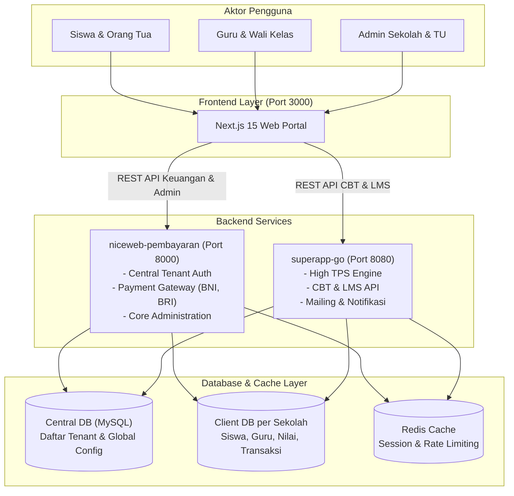

# Ringkasan Arsitektur Sistem

Ekosistem **Schools Super Workspace** dirancang menggunakan pendekatan hybrid monorepo yang memadukan service Laravel, Go, dan Next.js dengan pemisahan database per tenant (*database-per-tenant isolation*).

---

## High-Level Diagram

---

## Komponen Utama

### 1. `niceweb-pembayaran` (Laravel Backend)
- Menangani pendaftaran dan metadata sekolah di **Central DB**.
- Menangani transaksi pembayaran, auto-debit, webhook/callback bank (BNI/BRI).
- Mengelola permission, role, dan policy generator.

### 2. `superapp-go` (Go Backend API v2)
- Dirancang untuk menangani beban tinggi (*concurrency tinggi*) seperti ujian online serentak (CBT).
- Menghubungkan koneksi database client secara dinamis berdasarkan identifier sekolah di header/token request.

### 3. `superapp-frontend` (Next.js 15)
- Menyediakan UI responsif untuk dashboard admin sekolah, guru, dan portal siswa.
- Mengintegrasikan state auth dan hak akses (*role-based access control*).
