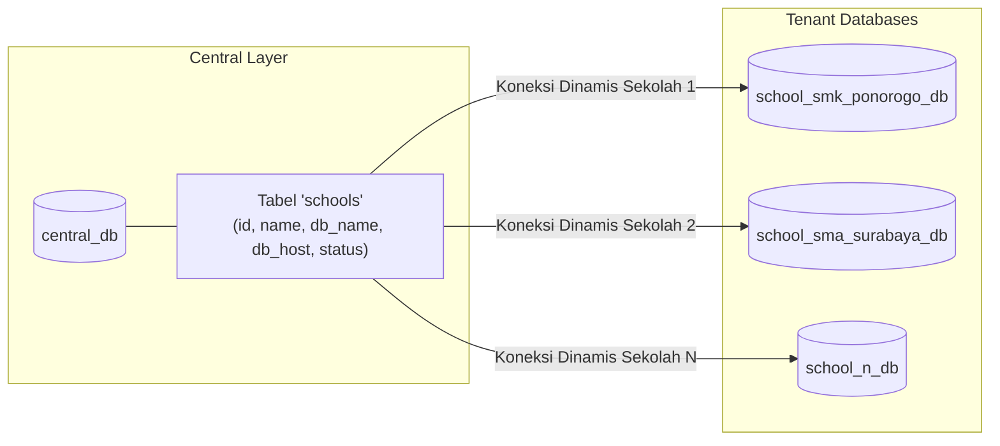

# Arsitektur Multi-Tenancy

Sistem ini menerapkan pola **Multi-Tenant Database Isolation (Database-per-Tenant)** untuk menjamin privasi data antar sekolah, kepatuhan regulasi, dan performa query yang terisolasi.

---

## Pemisahan Database



---

## Alur Penentuan Tenant Saat Request Masuk

1. **Identifikasi Header / Subdomain**:
   Setiap request dari klien membawa identitas tenant via header:
   ```http
   X-School-ID: 1
   # atau via Bearer Token JWT payload
   ```
2. **Lookup Konfigurasi**:
   Backend membaca tabel `schools` di `central_db` (dengan cache Redis) untuk mengambil kredensial database sekolah tersebut.
3. **Koneksi Dinamis (Tenant Switcher)**:
   - Di **Laravel**: Middleware mengubah koneksi database default ke koneksi `tenant`.
   - Di **Go**: Repository/Service mengambil koneksi pool database yang telah di-cache untuk ID sekolah tersebut.
