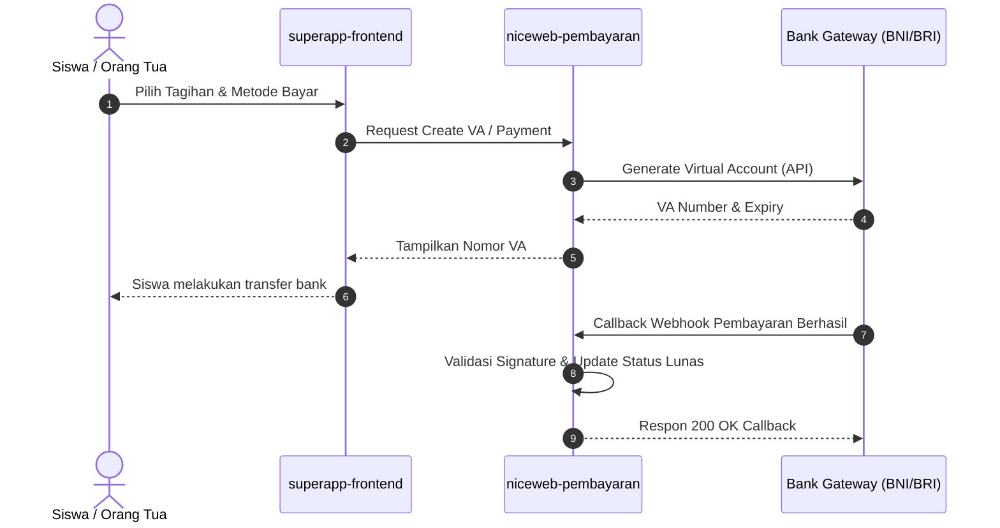

# Modul Keuangan & Pembayaran SPP

Modul keuangan dikelola secara terpusat melalui service `niceweb-pembayaran` untuk mengelola tagihan siswa, auto-debit, serta integrasi payment gateway.

---

## Integrasi Payment Gateway

Sistem mendukung multiple payment provider:
- **BNI Virtual Account & Autodebit**
- **BRI Virtual Account**
- **BCA Virtual Account**

---

## Alur Pembayaran & Webhook Callback

