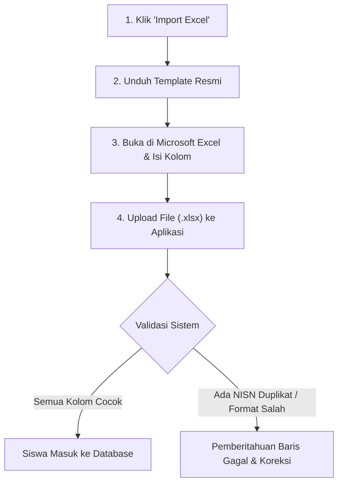

# ‍ Data Siswa

Menu **Data Siswa** adalah pusat pengelolaan biodata peserta didik di sekolah, status keaktifan, penempatan kelas, serta penerbitan kartu identitas pelajar digital.

---

## Tampilan Halaman Data Siswa

---

## 1. Pencarian & Filter Data Siswa

- **Pencarian Cerdas**: Masukkan **Nama Siswa**, **NISN**, atau **Username** pada kolom pencarian. Hasil pencarian akan langsung tersaring secara realtime.
- **Filter Kelas**: Pilih kelas tertentu (misal: *7 - 7 REGULER H* atau *X RPL 1*) untuk menampilkan hanya siswa di rombel tersebut.
- **Centang Kotak Pilihan (Checkbox)**: Digunakan untuk memilih beberapa siswa sekaligus guna melakukan aksi massal (seperti ekspor pilihan atau mutasi kelas bersamaan).

---

## 2. Alur Menambah Siswa Baru (Manual)

Gunakan cara ini ketika ada siswa baru pindahan atau pendaftaran satuan:

### Formulir yang Perlu Diisi:
1. Klik tombol **`+ Tambah Siswa`** berwarna biru di pojok kanan atas.
2. Isi data pokok siswa:
   - **NISN (Nomor Induk Siswa Nasional)** *(Wajib)*: 10 digit nomor resmi Kemendikbud/Kemenag. Wajib unik karena digunakan sebagai identitas akun login dan Virtual Account bank.
   - **NIS Sekolah** *(Wajib)*: Nomor induk lokal sekolah.
   - **Nama Lengkap Siswa** *(Wajib)*: Sesuai ijazah atau akta kelahiran.
   - **Jenis Kelamin** *(Wajib)*: Laki-Laki / Perempuan.
   - **Tanggal Lahir**: Digunakan untuk verifikasi tanggal lahir dan password default awal.
   - **Kelas / Rombel** *(Wajib)*: Tentukan kelas awal siswa (misal: *7 - REGULER H*).
   - **Nomor Telepon / WhatsApp Orang Tua**: Nomor aktif untuk pengiriman otomatis notifikasi tagihan SPP dan presensi harian.
3. Klik tombol **`Simpan Data Siswa`**.

---

## 3. Alur Mengedit & Memperbarui Data Siswa

1. Cari siswa pada tabel, lalu klik **Ikon Edit (Pensil)** di kolom aksi sebelah kanan.
2. Perbarui informasi yang diperlukan (misal: perubahan nomor HP orang tua atau pembetulan ejaan nama).
3. Klik tombol **`Simpan Perubahan`**.

---

## 4. Alur Import Data Siswa Massal via Excel

Fitur ini sangat krusial saat menyambut tahun ajaran baru untuk memasukkan ratusan siswa baru sekaligus dalam sekali proses:

### Panduan Mengisi Template Excel:
1. Klik tombol **`Import Excel`** di atas tabel.
2. Klik tautan **Unduh Format Template Siswa (.xlsx)**.
3. Buka file di Excel. Pastikan tidak mengubah susunan nama kolom pada baris pertama:
   - **Kolom `nisn`**: Pastikan diformat sebagai *Text* di Excel agar angka `0` di depan tidak hilang.
   - **Kolom `nama`**: Nama lengkap siswa huruf kapital/standar.
   - **Kolom `jenis_kelamin`**: Isi `L` untuk Laki-laki atau `P` untuk Perempuan.
   - **Kolom `kode_kelas`**: Isi kode rombel yang persis dengan nama kelas di sistem (misal: *7A*, *X-RPL-1*).
   - **Kolom `tanggal_lahir`**: Format `YYYY-MM-DD` (contoh: `2014-04-01`).
4. Simpan file, lalu unggah kembali ke modal sistem.
5. Klik **`Unggah & Proses`**. Sistem akan membaca dan mengimpor seluruh baris secara otomatis.

---

## 5. Alur Export Data Siswa ke Excel

1. Tentukan filter terlebih dahulu (misal: pilih *Semua Kelas* atau kelas tertentu).
2. Klik tombol hijau **`Export Excel`**.
3. File spreadsheet berekstensi `.xlsx` akan langsung terunduh ke komputer Anda, memuat rekap seluruh siswa lengkap dengan NISN, nama, kelas, jenis kelamin, dan status keaktifan.
