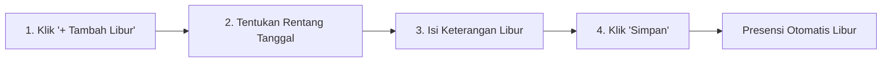

# Hari Libur

Menu **Hari Libur** digunakan untuk menetapkan hari libur nasional, cuti bersama, atau hari libur khusus internal sekolah agar mesin absensi dan rekapitulasi kehadiran tidak menandai siswa sebagai alfa/membolos.

---

## Tampilan Pengaturan Hari Libur

---

## 1. Alur Menambah Hari Libur

### Langkah-langkah:
1. Buka menu **Data Master** **Hari Libur**.
2. Klik tombol **`+ Tambah Hari Libur`**.
3. Lengkapi data:
   - **Nama Hari Libur** *(Wajib)*: Contoh: *Libur Idul Fitri 1448 H*, *Hari Kemerdekaan RI*, *Libur Semester Ganjil*.
   - **Tanggal Mulai**: Tanggal awal libur.
   - **Tanggal Selesai**: Tanggal akhir libur (bisa diisi sama jika hanya 1 hari).
   - **Keterangan / Kategori**: Libur Nasional / Cuti Bersama / Libur Khusus Sekolah.
4. Klik tombol **`Simpan Hari Libur`**.
5. Pada tanggal-tanggal tersebut, sistem presensi akan otomatis libur dan tidak menghasilkan rekapitulasi siswa alfa.
