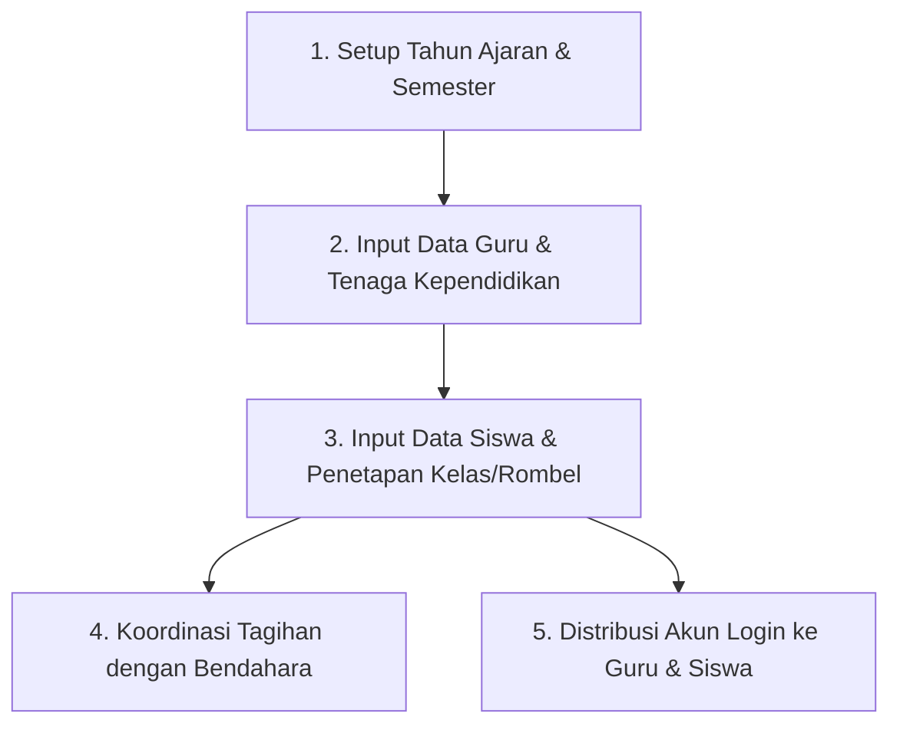

# Panduan Admin Sekolah & Tata Usaha (TU)

Modul Administrator dirancang khusus untuk staf Tata Usaha dan Admin Utama sekolah guna mengelola operasional harian sekolah, data induk siswa, kalender akademik, serta hak akses seluruh pengguna.

---

## Alur Kerja Utama Administrator

---

## Daftar Panduan di Bagian Ini

1. **[Pengaturan Tahun Ajaran & Profil Sekolah](/panduan-admin/data-sekolah)**: Mengatur identitas sekolah, mengaktifkan tahun ajaran berjalan, dan menyusun semester.
2. **[Manajemen Data Siswa & Rombel](/panduan-admin/data-siswa)**: Tambah siswa satu per satu, impor massal dari file Excel Dapodik, pembagian rombel, mutasi siswa, dan kenaikan kelas.
3. **[Manajemen Guru & Akun Pengguna](/panduan-admin/data-guru-staf)**: Menambahkan guru baru, menugaskan wali kelas, dan mereset kata sandi pengguna yang lupa password.
4. **[Pembuatan Surat & Inventaris Sarpras](/panduan-admin/persuratan-sapras)**: Membuat surat keterangan aktif belajar otomatis dan mencatat inventaris barang sekolah.
