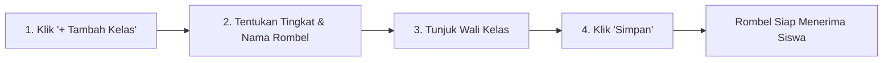

# Kelas & Rombel

Menu **Kelas** mengelola struktur rombongan belajar (Rombel), tingkatan kelas, penetapan Wali Kelas, serta daya tampung siswa per ruangan.

---

## Tampilan Manajemen Kelas

---

## 1. Alur Menambah Kelas / Rombel Baru

### Langkah-langkah:
1. Klik tombol **`+ Tambah Kelas`** di pojok kanan atas.
2. Lengkapi isian formulir:
   - **Tingkat Pendidikan**: Pilih tingkat (misal: *Kelas 7*, *Kelas 8*, *Kelas 9* atau *X*, *XI*, *XII*).
   - **Nama Rombel** *(Wajib)*: Contoh: *7 - AL FUQON*, *X RPL 1*, *XI IPA 2*.
   - **Tahun Ajaran Aktif**: Otomatis tertaut pada periode berjalan.
   - **Wali Kelas**: Pilih nama guru dari daftar dropdown yang ditugaskan membina kelas ini.
   - **Kapasitas Maksimal**: Batas kuota siswa per kelas (misal: *36 siswa*).
3. Klik tombol **`Simpan Kelas`**.

---

## 2. Mengubah Data Kelas & Mengganti Wali Kelas

1. Cari kelas yang ingin disesuaikan pada tabel.
2. Klik tombol **Edit**.
3. Anda dapat memperbarui nama rombel atau mengganti penugasan Wali Kelas baru.
4. Klik **`Simpan Perubahan`**. Guru yang baru ditunjuk otomatis akan memiliki akses ke **Dashboard Wali Kelas** untuk rombel tersebut.
