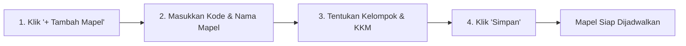

# Mata Pelajaran

Modul **Mata Pelajaran** digunakan untuk mengelola daftar mata pelajaran (Mapel), kode kurikulum, kelompok mapel, serta Kriteria Ketuntasan Minimal (KKM / KKTP).

---

## Tampilan Halaman Mata Pelajaran

---

## 1. Alur Menambah Mata Pelajaran Baru

### Langkah-langkah:
1. Klik tombol **`+ Tambah Mata Pelajaran`** di pojok kanan atas tabel.
2. Lengkapi isian data:
   - **Kode Mapel** *(Wajib)*: Contoh: `PAI-01`, `MAT-X`, `BINDO-01`.
   - **Nama Mata Pelajaran** *(Wajib)*: Contoh: *Pendidikan Agama Islam*, *Matematika Wajib*.
   - **Kelompok Mapel**: Pilih kelompok (Kelompok A Wajib, Kelompok B Umum, Kelompok C Peminatan/Kejuruan, atau Muatan Lokal).
   - **KKM Standar**: Nilai batas ketuntasan (misal: *75*).
3. Klik tombol **`Simpan Mapel`**.

---

## 2. Mengedit & Menghapus Mapel

- **Edit Mapel**: Klik ikon pensil untuk mengubah nama atau batas nilai KKM.
- **Hapus Mapel**: Klik ikon tempat sampah jika mata pelajaran sudah tidak lagi diajarkan pada kurikulum berjalan.
