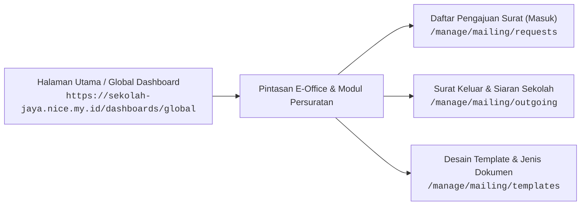
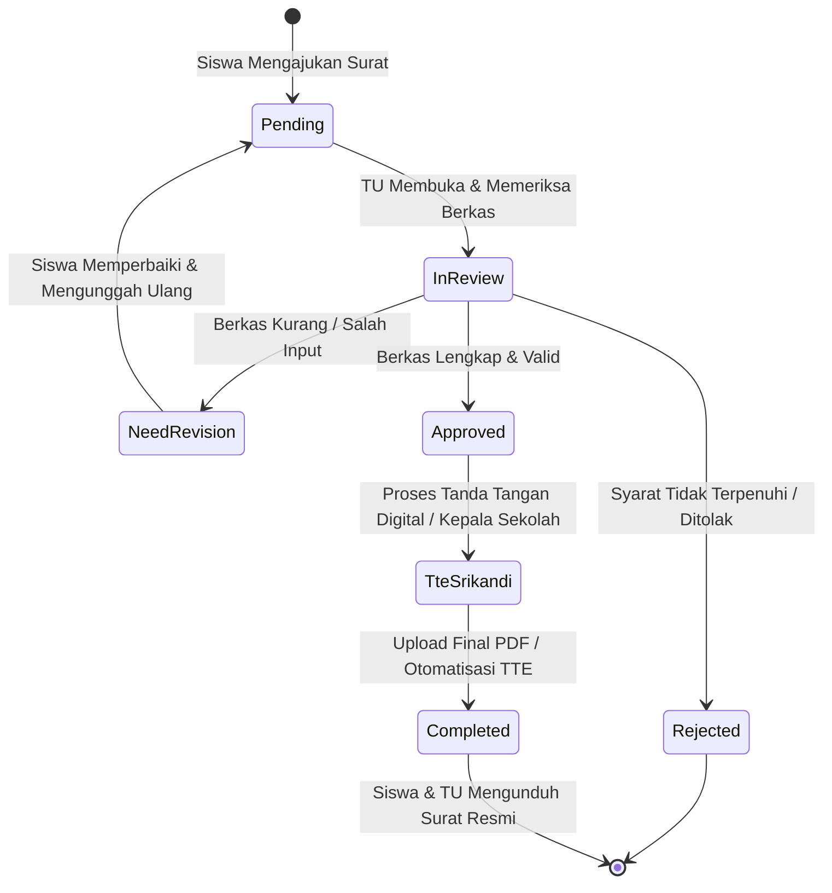
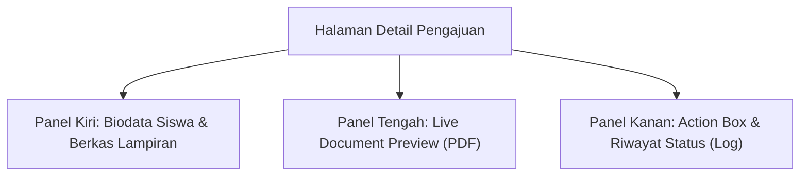
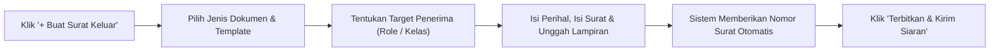
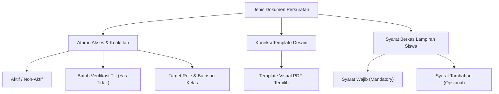

# 📨 Persuratan & E-Office Sekolah

Modul **Persuratan & E-Office (Mailing System)** adalah pusat tata kelola administrasi dokumen resmi sekolah secara terpadu. Sistem ini mencakup pengajuan surat mandiri oleh siswa, alur verifikasi berkas oleh staf Tata Usaha (TU), tanda tangan digital TTE / SRIKANDI, penerbitan surat keluar / surat edaran siaran, hingga manajemen template dan arsip dinamis.

---

## 🌐 Navigasi & Integrasi Global Dashboard

Pengguna (Admin TU, Kepala Sekolah, maupun Staf) dapat memantau notifikasi persuratan dan membuka modul persuratan langsung dari **Global Dashboard** sekolah:



> [!NOTE]
> Modul persuratan dirancang *paperless* dan *multi-tenant* sehingga setiap sekolah memiliki nomor surat otomatis, kop surat dinamis, serta stempel digital yang terisolasi dan aman.

---

## 🔄 Status State Machine Pengajuan Surat

Setiap berkas surat yang diajukan oleh siswa melalui portal mandiri akan melalui siklus verifikasi dan validasi bertingkat sebelum dokumen final diterbitkan:



| Kode Status | Label Status di Sistem | Deskripsi & Aksi Lanjutan |
| :--- | :--- | :--- |
| `pending` | **Pengajuan Masuk (Menunggu)** | Permohonan baru dikirim oleh siswa, menunggu antrean pemeriksaan TU. |
| `in_review` | **Sedang Diverifikasi TU** | Berkas dan biodata siswa sedang dicocokkan dengan arsip data pokok. |
| `need_revision` | **Perlu Perbaikan / Revisi** | Berkas lampiran buram, salah, atau data belum lengkap. Siswa wajib revisi. |
| `rejected` | **Ditolak** | Pengajuan ditolak secara permanen disertai alasan penolakan dari TU. |
| `approved` / `verified_by_tu` | **Disetujui TU** | Verifikasi selesai, sistem membuat draft PDF untuk proses TTE Kepala Sekolah. |
| `completed` | **Surat Terbit (Selesai)** | Dokumen resmi dengan barcode validasi & stempel telah aktif untuk diunduh. |

---

## Bab 1: Alur Pengajuan Surat Masuk & Verifikasi TU

Halaman ini digunakan oleh staf Tata Usaha untuk mengelola seluruh permohonan surat dari siswa (misalnya: *Surat Keterangan Siswa Aktif Belajar*, *Surat Rekomendasi Beasiswa*, *Surat Dispensasi Mengikuti Lomba*, dan *Surat Keterangan Berkelakuan Baik*).


### 1. Filter & Manajemen Antrean Pengajuan
1. **Pencarian Cerdas**: Cari permohonan berdasarkan **Nama Siswa**, **NISN**, atau **Nomor Registrasi Surat**.
2. **Tab Status Cepat**: Filter antrean berdasarkan tab status: `Semua`, `Menunggu Verifikasi`, `Perlu Revisi`, `Disetujui`, `Selesai`, dan `Ditolak`.
3. **Pemeriksaan Detail**: Klik tombol **Lihat Detail** atau ikon panah pada baris siswa untuk membuka halaman audit pengajuan.

---

### 2. Panel Detail Pengajuan & Aksi Approval TU (`/manage/mailing/requests/[id]`)

Pada halaman detail pengajuan, staf TU disajikan data lengkap dalam 3 panel utama:



#### Langkah Memproses Surat:
1. **Periksa Berkas Lampiran**:
   - Periksa lampiran berkas yang diunggah siswa (misalnya: *Scan Kartu Keluarga*, *Kartu Pelajar*, atau *Bukti Prestasi*).
   - Klik pratinjau berkas untuk memastikan gambar/PDF jelas dan dapat dibaca.
2. **Generate Draft PDF Otomatis**:
   - Sistem secara otomatis menginjeksi variabel biodata siswa (`{{nama_siswa}}`, `{{nisn}}`, `{{kelas}}`, `{{tempat_tanggal_lahir}}`) ke dalam template surat.
   - Periksa pratinjau draft di layar.
3. **Pilih Keputusan TU**:
   - **Minta Revisi**: Masukkan catatan perbaikan (contoh: *"Foto KK terpotong pada bagian nama orang tua, mohon unggah ulang foto yang jelas"*). Status berubah menjadi `need_revision` dan siswa menerima notifikasi.
   - **Tolak Pengajuan**: Masukkan alasan penolakan definitif. Status berubah menjadi `rejected`.
   - **Setujui (Approve)**: Verifikasi dokumen berhasil. Sistem menerbitkan nomor surat resmi sesuai format penomoran sekolah.
4. **Penerbitan Dokumen Final**:
   - Staf TU dapat mengunggah file PDF yang telah ditandatangani secara elektronik (TTE SRIKANDI / Kepala Sekolah) melalui tombol **Unggah Dokumen Final**, atau menyetujui penerbitan instan dengan stempel digital sekolah.

---

## Bab 2: Penerbitan & Penomoran Otomatis Surat Keluar

Halaman **Surat Keluar & Siaran Sekolah** digunakan untuk menerbitkan surat edaran resmi dari pihak pimpinan sekolah yang ditujukan kepada seluruh warga sekolah, guru, karyawan, maupun rombel kelas tertentu.


### Alur Penerbitan Surat Keluar:



### Rincian Formulir Surat Keluar:

| Nama Kolom / Input | Tipe Input | Wajib | Keterangan & Penggunaan |
| :--- | :--- | :---: | :--- |
| **Jenis Dokumen** | Dropdown Pilihan | Ya | Memilih kategori surat (Surat Edaran Libur, Undangan Rapat Wali Murid, dsb). |
| **Nomor Surat** | Otomatis / Manual | Ya | Nomor surat di-generate otomatis sesuai format penomoran aktif. |
| **Judul / Perihal** | Teks | Ya | Perihal surat resmi yang tampil sebagai judul pengumuman. |
| **Target Penerima** | Pilihan Multi-Role | Ya | Opsi: `Semua`, `Siswa Saja`, `Guru Saja`, atau `Staf / Karyawan`. |
| **Spesifikasi Kelas** | Dropdown Rombel | Opsional | Jika target adalah siswa, dapat dibatasi hanya untuk kelas tertentu (misal: *Kelas IX*). |
| **Isi Dokumen / Surat** | Rich Text Editor | Ya | Narasi lengkap surat edaran atau ringkasan pengumuman resmi. |
| **File Lampiran (PDF)** | Upload File | Opsional | Dokumen PDF resmi berkop dan bertanda tangan basah / stempel sekolah. |

---

## Bab 3: Pengaturan Jenis Dokumen & Persyaratan Berkas

Menu **Jenis Dokumen Persuratan** adalah katalog surat yang dapat dipilih oleh siswa saat membuat pengajuan mandiri, lengkap dengan aturan verifikasi dan syarat dokumen yang wajib dilampirkan.


### Rincian Konfigurasi Jenis Dokumen:



### Panduan Menambah Jenis Dokumen Baru:
1. Masuk ke menu **Jenis Dokumen** (`/manage/mailing/document-types`) lalu klik tombol **`+ Tambah Jenis Dokumen`**.
2. Lengkapi parameter berikut:
   - **Nama Dokumen**: Contoh *Surat Keterangan Aktif Belajar*.
   - **Template Terkait**: Pilih master template surat yang sudah dirancang sebelumnya.
   - **Wajib Verifikasi TU**: Aktifkan centang ini agar pengajuan harus diperiksa TU terlebih dahulu sebelum terbit.
   - **Target Pengguna**: Tentukan siapa yang boleh mengajukan (`Siswa`, `Guru`, atau `Semua`).
   - **Berlaku untuk Semua Kelas**: Pilih *Ya*, atau tentukan rombel khusus jika surat hanya diperuntukkan bagi tingkatan tertentu.
3. **Persyaratan Dokumen (Attachments)**:
   - Klik **`+ Tambah Syarat Berkas`**.
   - Beri nama syarat (contoh: *Scan Akta Kelahiran*, *Scan Kartu Keluarga*).
   - Centang kotak **Wajib Diunggah** jika berkas tersebut mutlak diperlukan.
4. Klik **`Simpan Dokumen`**.

---

## Bab 4: Visual Template Builder & Variabel Dinamis

Menu **Desain & Template Surat** menyediakan kanvas visual interaktif (*Visual Template Builder*) untuk menyusun tata letak dokumen surat resmi berstandar nasional.


### 1. Panel Editor & Kanvas Penempatan Komponen

Visual Template Builder memungkinkan staf TU menarik (*drag and drop*) komponen dinamis langsung ke atas lembar kerja surat:


### 2. Daftar Variabel Dinamis yang Didukung Sistem

Variabel dinamis ditulis menggunakan kurung kurawal ganda `{{nama_variabel}}`. Sistem akan otomatis mengganti variabel ini dengan data riil pemohon saat surat digenerate:

#### A. Variabel Biodata Siswa:
- `{{nama_siswa}}` : Nama lengkap siswa sesuai data pokok.
- `{{nisn}}` : Nomor Induk Siswa Nasional (10 digit).
- `{{nis}}` : Nomor Induk Siswa lokal sekolah.
- `{{kelas}}` : Nama rombel kelas aktif siswa saat ini.
- `{{jenis_kelamin}}` : Laki-Laki / Perempuan.
- `{{tempat_tanggal_lahir}}` : Tempat dan tanggal lahir siswa (contoh: *Ponorogo, 12 Mei 2008*).
- `{{alamat_siswa}}` : Alamat domisili lengkap siswa.
- `{{nama_ayah}}` / `{{nama_ibu}}` : Nama orang tua / wali murid.

#### B. Variabel Instansi & Tanggal Surat:
- `{{nama_sekolah}}` : Nama resmi satuan pendidikan.
- `{{npsn}}` : Nomor Pokok Sekolah Nasional.
- `{{alamat_sekolah}}` : Alamat lengkap instansi sekolah.
- `{{kepala_sekolah}}` : Nama lengkap Kepala Sekolah beserta gelar.
- `{{nip_kepala_sekolah}}` : NIP resmi Kepala Sekolah.
- `{{nomor_surat}}` : Nomor surat resmi yang digenerate sistem.
- `{{tanggal_surat}}` : Tanggal surat diterbitkan dalam format Bahasa Indonesia baku.

---

### 3. Pengaturan Kop Surat & Variabel Global (`/manage/mailing/variables`)

Pengaturan variabel global digunakan untuk menyimpan data statis sekolah seperti logo instansi, logo kementerian, alamat kop surat, email resmi, dan stempel sekolah.


#### Variabel Sekolah yang Dapat Dikelola:
1. **`kop_logo_kiri`**: Logo resmi Pemerintah Provinsi / Kementerian Pendidikan.
2. **`kop_logo_kanan`**: Logo resmi satuan pendidikan sekolah.
3. **`kop_header_1`**: Baris instansi utama (contoh: *PEMERINTAH PROVINSI JAWA TIMUR*).
4. **`kop_header_2`**: Dinas terkait (contoh: *DINAS PENDIDIKAN & KEBUDAYAAN*).
5. **`kop_nama_sekolah`**: Nama sekolah (contoh: *SEKOLAH JAYA PONOROGO*).
6. **`kop_alamat_kontak`**: Jalan, nomor telepon, website, dan kode pos resmi.
7. **`stempel_sekolah`**: File gambar stempel transparan (.png) untuk pembubuhan cap resmi otomatis.

---

### 4. Format Rumus Penomoran Surat Otomatis

Sistem menyediakan konfigurasi penomoran surat dinamis dengan format pola yang dapat disesuaikan:

```text
[NOMOR_URUT]/[KODE_KLASIFIKASI]/[KODE_SEKOLAH]/[BULAN_ROMAWI]/[TAHUN]
```

**Contoh Format**:  
`421.1/{counter}/{kode_arsip}/SKJ/{roman_month}/{year}`  
**Hasil Penerbitan**:  
`421.1/042/SK-AKTIF/SKJ/XI/2026`

*Tag Pola yang Tersedia:*
- `{counter}` : Nomor urut surat (otomatis bertambah dan dapat di-reset per tahun ajaran).
- `{roman_month}` : Angka bulan berjalan dalam bilangan Romawi (`I` s.d `XII`).
- `{month}` : Angka bulan 2 digit (`01` s.d `12`).
- `{year}` : Tahun berjalan 4 digit (`2026`).

---

## Bab 5: Klasifikasi & Kategori Arsip Persuratan

Menu **Kategori Arsip Surat** berfungsi untuk mengelompokkan arsip persuratan berdasarkan tata kearsipan nasional (Pola Klasifikasi Surat Dinas).


### Manfaat Pengkategorian Arsip:
1. **Pemisahan Klasifikasi Dokumen**: Membedakan surat kesiswaan, kepegawaian, surat dinas masuk, dan surat edaran umum.
2. **Pencarian Cepat dalam Buku Agenda**: Tata Usaha dapat memfilter riwayat surat keluar dan masuk berdasarkan kategori tertentu saat akreditasi atau audit dinas.
3. **Penyimpanan Digital Terstruktur**: Setiap surat yang diterbitkan secara otomatis terindeks pada kategori arsip masing-masing.

---

## 🎓 Portal Pengajuan Surat Mandiri Siswa

Siswa dan orang tua dapat mengajukan permohonan surat secara mandiri dari portal web maupun aplikasi Android tanpa perlu mengantre di ruang Tata Usaha.


### Langkah Siswa Mengajukan Surat:
1. **Pilih Jenis Dokumen**:
   - Buka menu **Persuratan** pada portal siswa (`/student/mailing`).
   - Pilih jenis surat yang dibutuhkan (misalnya: *Surat Keterangan Siswa Aktif*).
2. **Isi Formulir & Keperluan**:
   - Masukkan peruntukan surat (contoh: *"Pengurusan Tunjangan Gaji Orang Tua PNS"* atau *"Persyaratan Pendaftaran Beasiswa"*).
   - Biodata pokok (NISN, Nama, Kelas) otomatis terisi dari akun siswa.
3. **Unggah Berkas Lampiran Syarat**:
   - Unggah dokumen yang diminta oleh sekolah (contoh: *Foto Kartu Keluarga* atau *Bukti Prestasi*).
4. **Kirim Permohonan**:
   - Klik **`Ajukan Surat`**. Permohonan akan masuk ke daftar verifikasi Tata Usaha sekolah.
5. **Pantau Status & Unduh Hasil**:
   - Status permohonan dapat dipantau langsung dari layar portal:
     - 🟡 **Menunggu Verifikasi**: Permohonan sedang dalam antrean staf TU.
     - 🔵 **Perlu Revisi**: Klik pengajuan untuk melihat catatan perbaikan dan unggah ulang berkas.
     - 🟢 **Selesai / Terbit**: Klik tombol **`Unduh Surat (PDF)`** untuk menyimpan surat resmi berkop, bernomor, dan bertanda tangan sah.
