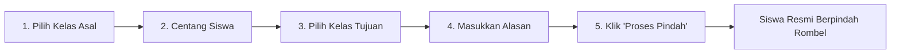

# Pindah Kelas & Kenaikan Kelas

Fitur **Pindah Kelas** digunakan oleh staf Tata Usaha untuk mengelola mutasi rombel siswa dalam satu tingkat, kenaikan kelas massal antar-tingkat di akhir tahun ajaran, serta melacak riwayat historis mutasi siswa.

---

## Tampilan Halaman Pindah Kelas

---

## 1. Dua Mode Perpindahan Siswa

Aplikasi menyediakan dua skenario pemindahan kelas:
1. **Pindah Kelas Biasa (Reguler)**: Memindahkan satu atau beberapa siswa ke rombel lain dalam tingkatan yang sama (contoh: dari *Kelas 7A* ke *Kelas 7B*).
2. **Kenaikan Kelas (Massal / Opsi Acak)**: Memindahkan seluruh siswa yang lulus tingkat ke kelas tingkat berikutnya di tahun ajaran baru (contoh: seluruh siswa *Kelas 7* naik ke *Kelas 8*).

---

## 2. Langkah-Langkah Memindahkan Siswa (Pindah Biasa)

### Panduan Operasional:
1. Buka menu **Data Master** **Pindah Kelas** submenu **Proses Pindah**.
2. **Pilih Kelas Asal**: Tentukan rombel asal siswa yang akan dipindahkan.
3. Tabel akan menampilkan seluruh daftar siswa di kelas tersebut:
   - Beri tanda centang pada satu atau beberapa siswa yang akan dipindah.
4. **Pilih Kelas Tujuan**: Tentukan rombel baru bagi siswa terpilih.
5. **Alasan Pindah Kelas** *(Opsional)*: Tuliskan keterangan singkat perpindahan (contoh: *Permohonan orang tua / Penyesuaian minat jurusan*).
6. Klik tombol **`Proses Pindah Kelas`**.
7. Sistem otomatis memperbarui data rombel siswa, memindahkan absensi ke kelas baru, dan mencatat log perpindahan.

---

## 3. Melihat Riwayat Perpindahan Siswa

Untuk kebutuhan audit dan buku induk:
1. Buka submenu **Riwayat Pindah** (`/manage/students/class-transfer/history`).
2. Anda dapat melihat:
   - Nama Lengkap & NISN Siswa.
   - Kelas Lama Kelas Baru.
   - Tanggal dan Jam Perpindahan.
   - Petugas TU / Admin yang memproses.
   - Keterangan alasan perpindahan.
3. Anda dapat mencetak atau mengekspor riwayat mutasi ini ke format Excel.
