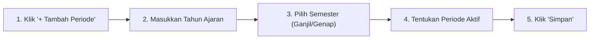

# Tahun Ajaran

Pengaturan periode kalender pendidikan dan semester aktif yang menjadi rujukan seluruh transaksi keuangan (SPP), presensi kelas, dan buku nilai rapor di sekolah.

---

## Tampilan Halaman Tahun Ajaran

---

## 1. Alur Menambah Tahun Ajaran Baru

### Langkah-langkah:
1. Klik tombol **`+ Tambah Tahun Ajaran`**.
2. Masukkan nama tahun akademik, misalnya: `2026/2027`.
3. Tentukan semester:
   - **Ganjil** (Juli s/d Desember)
   - **Genap** (Januari s/d Juni)
4. Tentukan status: Centang switch **Jadikan Periode Aktif** jika periode ini yang sedang berlangsung saat ini.
5. Klik **`Simpan`**.

::: warning Perhatian Saat Berganti Periode Aktif
Mengubah periode aktif akan otomatis mengalihkan pembukuan tagihan SPP dan presensi harian ke semester baru. Pastikan proses penilaian dan pembagian rapor pada semester sebelumnya telah selesai diverifikasi.
:::
