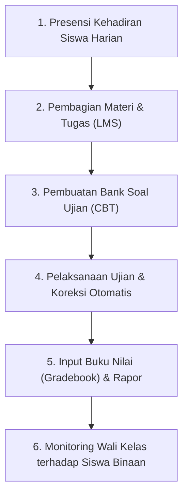

# ‍ Panduan Guru & Wali Kelas

Modul Akademik dirancang untuk mempermudah Bapak/Ibu Guru dalam menjalankan tugas pengajaran, penilaian, presensi siswa, pelaksanaan ujian online (CBT), serta pengawasan perwalian kelas.

---

## Alur Kerja Utama Guru

---

## Daftar Panduan di Bagian Ini

1. **[Pencatatan Presensi Harian Siswa](/panduan-guru/presensi-siswa)**: Cara mudah mengisi kehadiran (Hadir, Sakit, Izin, Alfa) per kelas atau per jam pelajaran.
2. **[Pelaksanaan Ujian Online (CBT)](/panduan-guru/ujian-cbt)**: Membuat bank soal, mengatur waktu ujian, mengaktifkan token, dan mengawasi jalannya ujian.
3. **[Unggah Materi & Tugas Siswa (LMS)](/panduan-guru/lms-materi)**: Membagikan dokumen bahan ajar, slide presentasi, video pembelajaran, dan tugas mandiri.
4. **[Input Buku Nilai & Rapor](/panduan-guru/rapor-nilai)**: Mengelola nilai tugas, ulangan harian, PTS, PAS, dan kalkulasi nilai akhir rapor.
5. **[Dashboard Perwalian Wali Kelas](/panduan-guru/dashboard-walikelas)**: Khusus Wali Kelas untuk memantau kehadiran, statistik pembayaran, dan catatan pembinaan siswa kelasnya.
