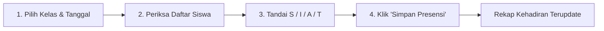

# Pencatatan Presensi Harian Siswa

Guru atau Wali Kelas dapat melakukan pencatatan kehadiran siswa secara digital langsung dari laptop maupun smartphone tanpa perlu buku absen kertas.

---

## Tampilan Halaman Presensi Siswa

---

## Langkah Pengisian Absensi Kelas

### Langkah-langkah:
1. Buka menu **Manajemen Absensi** **Absensi Siswa**.
2. Pilih **Kelas** yang sedang Anda ajar (misal: *Kelas 7 - AL FUQON*).
3. Tentukan tanggal presensi (default: hari ini).
4. Layar menampilkan seluruh siswa di kelas tersebut:
   - Secara default, seluruh siswa tercentang **Hadir (H)**.
5. Anda cukup menandai siswa yang berhalangan:
   - **S (Sakit)**: Siswa sakit (bisa lampirkan foto surat dokter).
   - **I (Izin)**: Siswa mengajukan izin resmi keluarga.
   - **A (Alfa)**: Siswa tidak hadir tanpa kabar.
   - **T (Terlambat)**: Siswa hadir melewati jam bel masuk.
6. Klik tombol **`Simpan Presensi`**.

::: tip Mesin Fingerprint & Tap Kartu RFID
Jika sekolah menggunakan gerbang mesin tap RFID atau sidik jari di pintu masuk, jam kedatangan dan jam pulang siswa otomatis tercatat secara realtime di halaman ini tanpa perlu input manual.
:::
