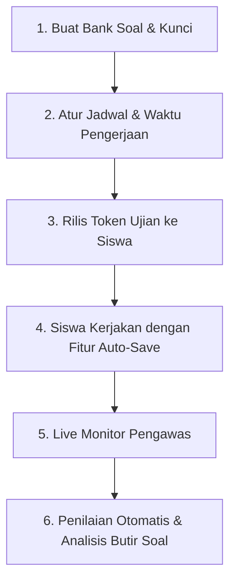

# Pelaksanaan Ujian Online (CBT)

Sistem Computer-Based Testing (CBT) ditenagai oleh mesin backend berkecepatan tinggi yang mampu menangani ribuan siswa mengerjakan ujian serentak tanpa kendala lag atau server down.

---

## Tampilan Manajemen Ujian CBT

---

## Alur Pelaksanaan Ujian Online

### Langkah-langkah:
1. **Membuat Bank Soal**:
   - Masuk ke menu **CBT** **Bank Soal**.
   - Klik **`+ Tambah Bank Soal`**, pilih mata pelajaran dan tingkat kelas.
   - Masukkan butir-butir soal (pilihan ganda / esai) atau unggah massal melalui file Word/Excel.
2. **Membuat Jadwal & Token**:
   - Masuk ke tab **Jadwal Ujian** Klik **`+ Jadwal Baru`**.
   - Tentukan kelas peserta, tanggal ujian, dan durasi (misal: *90 menit*).
   - Aktifkan fitur **Acak Soal** dan **Acak Pilihan Opsi** guna mencegah kecurangan.
   - Centang opsi **Token Ujian** dan buat 6 karakter kode rahasia.
3. **Pengawasan Langsung (Live Monitoring)**:
   - Saat ujian berlangsung, pengawas membuka layar pantau untuk melihat status tiap siswa (Sedang Mengerjakan, Belum Mulai, Sudah Selesai).
   - Pengawas dapat melakukan **Reset Login** jika laptop siswa mendadak mati.
