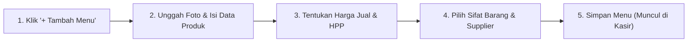

# Manajemen Menu & Cetak Barcode

Halaman **Daftar Menu** digunakan oleh pengelola kantin dan koperasi untuk mengatur seluruh katalog produk yang dijual, menetapkan harga jual dan harga modal (HPP), mengontrol sisa stok, mencetak lembar barcode produk, hingga mengimpor menu secara massal melalui file Excel.

Menu ini dapat diakses melalui **Kantin** > **Menu** pada sidebar aplikasi.

---

## Tampilan Halaman Daftar Menu

Berikut adalah tampilan antarmuka manajemen menu kantin sekolah:

---

## 1. Alur Menambahkan Menu Makanan / Minuman Baru

### Langkah-langkah:
1. Klik tombol **`+ Tambah Menu`** berwarna ungu di pojok kanan atas tabel.
2. Jendela modal formulir produk akan terbuka. Isi kolom-kolom berikut:
   - **Foto Menu**: Unggah foto produk makanan/minuman yang menarik (format JPG/PNG, maks 2MB) agar kasir dan siswa mudah mengenali produk.
   - **Nama Menu** *(Wajib)*: Masukkan nama lengkap menu (contoh: *Donat Madu*, *Nasi Uduk Ayam*, *Es Teh Manis*).
   - **Kategori** *(Wajib)*: Pilih kelompok kategori yang sesuai (misal: *Gorengan*, *Makanan Berat*, *Minuman Dingin*, *Snack Kemasan*).
   - **Harga Jual** *(Wajib)*: Harga nominal yang harus dibayar oleh siswa (contoh: *Rp 5.000*).
   - **Harga Pokok / HPP (Harga Modal)**: Biaya modal per porsi untuk keperluan kalkulasi laba bersih kantin dan bagi hasil supplier.
   - **Sifat Barang**:
     - **Harian**: Makanan basah atau olahan cepat basi yang habis dalam satu hari (misal: gorengan, nasi bungkus, jajanan pasar). Makanan ini akan dihitung retur saat tutup buku sore hari.
     - **Tahan Lama**: Produk kemasan pabrik yang tidak basi dalam sehari (misal: biskuit, air mineral kemasan, pulpen, buku tulis).
   - **Jumlah Stok Awal**: Masukkan kuantiti stok yang tersedia saat ini di etalase kantin.
   - **Jenis Kepemilikan & Supplier**:
     - *Produk Mandiri*: Makanan yang diproduksi dan dijual langsung oleh pihak kantin sekolah.
     - *Konsinyasi (Titip Jual)*: Makanan yang dititipkan oleh pedagang/mitra luar (pilih nama supplier dari daftar mitra).
3. Klik tombol **Simpan Menu**. Menu baru seketika aktif dan siap dipilih pada layar kasir POS.

---

## 2. Alur Mengedit & Memperbarui Menu

1. Cari menu yang ingin diubah pada tabel produk menggunakan kolom pencarian atau filter kategori.
2. Pada kolom paling kanan (**Aksi**), klik **Ikon Edit (Pensil)**.
3. Ubah harga, perbarui foto, atau sesuaikan jumlah stok yang tersedia.
4. Klik **Perbarui Menu**. Perubahan harga akan langsung berlaku saat transaksi kasir berikutnya.

---

## 3. Fitur Cetak Lembar Barcode (*Print Barcode Sheet*)

Fitur ini sangat bermanfaat bagi stan kantin yang ingin mempercepat proses antrean menggunakan alat barcode scanner USB:

1. Di atas tabel menu, klik tombol **`Cetak Barcode`**.
2. Modal pratinjau lembar barcode akan terbuka menampilkan seluruh barcode produk yang tersusun rapi per baris dan kolom.
3. Anda dapat memilih opsi pencetakan:
   - **Lembar Kertas Stiker**: Dicetak pada kertas stiker untuk ditempel langsung pada bungkus makanan atau wadah etalase.
   - **Lembar Meja Kasir (Laminating)**: Dicetak pada selembar kertas HVS/karton untuk diletakkan di samping meja kasir. Kasir cukup mengarahkan scanner ke kode barcode di lembaran tersebut tanpa perlu mengetik nama menu.
4. Klik tombol **Cetak Sekarang (Print)**.

---

## 4. Fitur Impor Menu Massal dari Excel

Jika kantin memiliki puluhan hingga ratusan jenis produk baru di awal tahun ajaran, Anda dapat memasukkannya sekaligus menggunakan file Excel:

1. Klik tombol **`Import Excel`** berwarna hijau di atas tabel.
2. Unduh **Template Excel (.xlsx)** resmi yang disediakan oleh sistem.
3. Buka template tersebut dan isi data produk mengikuti susunan kolom yang ditentukan (Nama Menu, Kategori, Harga Jual, Harga Pokok, Sifat Barang, Stok Awal).
4. Simpan file Excel, lalu unggah kembali file ke dalam jendela modal impor.
5. Klik **Mulai Impor**. Sistem akan memvalidasi data dan seluruh menu akan terdaftar secara otomatis tanpa perlu input manual satu per satu.
