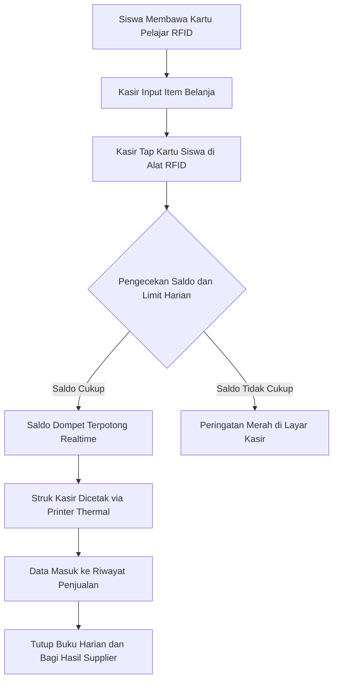

# Ekosistem Kantin & Koperasi Digital

Modul **Kantin & Koperasi Sekolah** adalah sistem terpadu untuk mengelola seluruh transaksi jual-beli makanan, minuman, dan perlengkapan siswa di lingkungan sekolah secara digital (*cashless*).

Modul ini menghubungkan kasir stan kantin, pengelola koperasi, bendahara sekolah, dan orang tua siswa dalam satu ekosistem transaksi yang aman, cepat, dan transparan.

---

## Tampilan Dashboard Kantin

Halaman dashboard memberikan gambaran performa penjualan, omset hari ini, item terlaris, serta status stok barang secara langsung (*realtime*):

---

## Alur Transaksi Non-Tunai (Cashless Flow)

Diagram alur berikut mengilustrasikan bagaimana transaksi belanja siswa diproses dari awal hingga tutup buku:

---

## Keunggulan Sistem Kantin Digital

1. **Bebas Antrean Panjang (Quick Checkout)**:
   Proses pembayaran hanya membutuhkan waktu 2–3 detik per siswa cukup dengan menempelkan kartu pelajar pada sensor RFID, tanpa perlu mencari uang kembalian.
2. **Perlindungan Uang Saku & Kontrol Orang Tua (Daily Limits)**:
   Orang tua tidak perlu khawatir uang saku anak hilang atau digunakan berlebihan, karena sistem membatasi batas jajan harian maksimal per hari.
3. **Pencatatan Konsinyasi & Kemitraan Otomatis**:
   Makanan yang dititipkan oleh pedagang luar (supplier mitra kantin) otomatis terhitung omsetnya, dipotong komisi kasir sekolah, dan siap dicairkan melalui fitur tutup buku.
4. **Higienis & Aman**:
   Mengurangi peredaran uang kertas dan koin di area makanan kantin sekolah, menciptakan lingkungan sekolah yang lebih sehat dan modern.

---

## Daftar Panduan Fitur di Modul Ini

1. **[Kasir POS & Scan Kartu RFID](/panduan-kantin/pos-kasir)**: Panduan lengkap bagi petugas kasir untuk melayani transaksi belanja siswa menggunakan kartu pelajar.
2. **[Manajemen Menu & Cetak Barcode](/panduan-kantin/daftar-menu)**: Cara mendaftarkan makanan, harga jual, harga pokok (HPP), kontrol stok, dan cetak lembaran barcode menu.
3. **[Batas Belanja Harian Siswa](/panduan-kantin/limit-harian)**: Pengaturan batas maksimal jajan per hari baik secara global maupun khusus per anak.
4. **[Tutup Buku & Settlement Supplier](/panduan-kantin/tutup-buku)**: Rekapitulasi omset, pembagian komisi kantin, dan pencairan pembayaran bagi pedagang titip jual.
5. **[Layanan Top-Up Saldo Siswa](/panduan-kantin/topup-saldo)**: Tata cara pengisian saldo dompet digital kartu siswa menggunakan setoran tunai.
