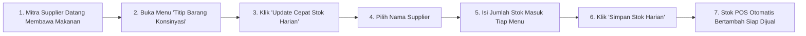

# Titip Barang Konsinyasi & Update Stok Harian

Fitur **Titip Barang Konsinyasi** digunakan oleh pengelola kantin untuk mencatat penerimaan barang dagangan titipan dari mitra pedagang luar (supplier) di pagi hari, memantau penjualan harian secara otomatis, dan menghitung sisa barang retur sore hari.

Fitur ini dapat diakses melalui menu **Kantin** > **Titip Barang Konsinyasi** (`/manage/kantin/consignments`).

---

## Tampilan Antarmuka Titip Barang Konsinyasi

Berikut adalah tampilan antarmuka pembaruan cepat stok harian barang titipan konsinyasi:

---

## 1. Alur Penerimaan Barang Titipan Pagi Hari

---

## 2. Fitur "Update Cepat Stok Harian" (Daily Fast-Replenishment)

Sebelumnya, pengelola harus menginput ulang satu per satu (*re-entry*) nama barang, harga modal, harga jual, dan supplier setiap pagi. Dengan fitur baru **Update Cepat Stok Harian**:

1. Klik tombol hijau **`Update Cepat Stok Harian`** di kanan atas tabel.
2. Jendela modal akan terbuka:
   - **Pilih Supplier**: Pilih nama mitra penitip (contoh: *Ibu Aminah - Pastel & Risoles*, *Pak Joko - Roti Bakar*).
   - **Tanggal Titipan**: Otomatis terisi tanggal hari ini (dapat disesuaikan jika perlu).
3. Sistem secara otomatis memuat seluruh daftar menu aktif yang terdaftar atas nama supplier tersebut beserta informasi harga modal (HPP), harga jual, dan sisa stok saat ini.
4. Pengelola cukup mengetik angka pada kolom **`Tambah: ... pcs`** untuk masing-masing makanan yang diantar pagi hari.
5. Klik **`Simpan Stok Harian`**.
6. Sistem memproses seluruh item titipan secara bersamaan (*batch save*) dan stok di kasir POS langsung bertambah seketika.

---

## 3. Filter & Pemilahan Laporan Berdasarkan Nama Supplier

Untuk mempermudah rekonsiliasi dan pengecekan barang per mitra:

- **Filter Supplier**: Gunakan dropdown **`Supplier`** di atas tabel untuk menyaring riwayat titipan hanya untuk supplier tertentu.
- **Filter Tanggal**: Tentukan rentang **`Dari Tanggal`** dan **`Sampai Tanggal`** untuk melihat akumulasi titipan mingguan atau bulanan.
- **Pencatatan Retur**: Klik tombol kuning **`Sisa / Retur`** pada baris makanan di akhir hari untuk mencatat sisa makanan yang tidak laku atau basi sebelum dilakukan tutup buku bagi hasil.
