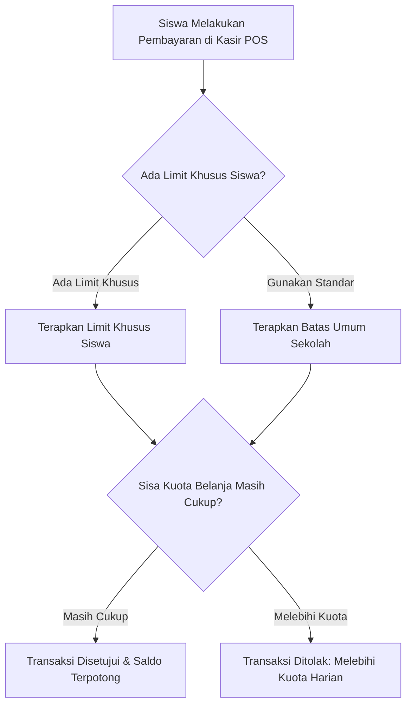

# Batas Belanja Harian Siswa (Daily Limits)

Fitur **Batas Belanja Harian** adalah sistem proteksi keuangan cerdas yang memungkinkan sekolah dan orang tua murid mengatur batas maksimal nominal uang jajan yang dapat dibelanjakan oleh seorang siswa di kantin sekolah dalam satu hari.

Fitur ini dapat diakses oleh Administrator dan Pengelola Kantin melalui menu **Kantin** > **Kelola Limit Harian** pada sidebar aplikasi.

---

## Tampilan Halaman Kelola Limit Harian

Berikut adalah tampilan antarmuka manajemen limit belanja harian:

---

## Tujuan & Manfaat Fitur Batas Jajan

1. **Mencegah Pemborosan Uang Saku**: Siswa belajar mengelola uang sakunya dengan bijak agar tidak menghabiskan seluruh saldo dompet digital dalam sekali istirahat.
2. **Proteksi Kartu Pelajar yang Hilang**: Jika kartu pintar siswa jatuh atau hilang, penemu kartu tidak dapat menguras seluruh saldo karena transaksi otomatis dibatasi oleh limit harian.
3. **Mendukung Pola Makan Sehat Siswa**: Orang tua murid dapat membatasi konsumsi makanan ringan di luar bekal rumah yang dibawa anak.
4. **Ketenangan bagi Orang Tua**: Orang tua dapat menitipkan saldo dalam jumlah besar (misal: Rp 200.000 untuk kebutuhan satu bulan) tanpa khawatir uang tersebut habis dalam 1–2 hari.

---

## 2 Tingkatan Limit Belanja

Sistem menerapkan hierarki proteksi dua tingkat yang sangat fleksibel:

### 1. Batas Umum Sekolah (*General Limit*)
Batas global yang berlaku untuk seluruh siswa di sekolah secara otomatis. Misalnya sekolah menetapkan standar umum maksimal jajan sebesar **Rp 25.000 per hari**.

### 2. Batas Khusus per Siswa (*Custom Student Limit*)
Batas nominal khusus yang ditetapkan atas permintaan wali murid untuk anak tertentu. Limit khusus ini akan mengabaikan (*override*) batas umum sekolah. Misalnya orang tua meminta anaknya hanya boleh jajan maksimal **Rp 10.000 per hari**.

---

## Alur Menetapkan Batas Belanja Khusus Siswa

1. Pada halaman **Kelola Limit Harian**, klik tombol ungu **`+ Tambah Limit`** di pojok kanan atas tabel.
2. Jendela modal formulir akan terbuka. Isi kolom-kolom berikut:
   - **Pilih Siswa** *(Wajib)*: Cari nama siswa atau NISN yang ingin diatur batas belanjanya.
   - **Nominal Limit Harian (Rp)** *(Wajib)*: Masukkan angka batas maksimal belanja dalam sehari (contoh: `15000`).
   - **Keterangan / Alasan**: Catatan alasan penetapan limit (contoh: *Permintaan ibu kandung via buku penghubung* atau *Anak dalam program diet makanan manis*).
   - **Status Limit**: Pilih status **Aktif**.
3. Klik tombol **Simpan Limit**.
4. Pembatasan ini seketika berlaku aktif secara realtime pada seluruh loket kasir POS kantin.

---

## Reaksi Sistem di Kasir POS Saat Siswa Melebihi Batas

Ketika siswa yang telah mencapai limit harian mencoba berbelanja lagi di kasir kantin:
1. Layar kasir POS seketika memunculkan peringatan berwarna merah:
   > **Peringatan: Melebihi Batas Belanja Harian!**  
   > Siswa ini telah berbelanja sebesar Rp 15.000 dari batas maksimal Rp 15.000 per hari.
2. Tombol pemotongan saldo dompet digital kartu terkunci otomatis demi melindungi saldo siswa.
3. Kasir dapat menyarankan siswa untuk menunggu hari esok saat kuota harian kembali ter-reset otomatis di jam 00.00 malam, atau membayar menggunakan uang tunai jika diizinkan oleh kebijakan sekolah.
