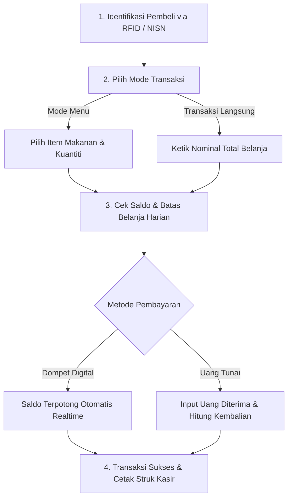

# Transaksi Kasir POS & Scan Kartu RFID

Aplikasi kasir **Point of Sale (POS) Kantin** dirancang khusus untuk melayani transaksi belanja siswa dengan kecepatan tinggi di jam istirahat sekolah yang padat.

Kasir dapat dioperasikan menggunakan komputer, laptop, tablet, atau mesin POS layar sentuh dengan scanner kartu RFID terhubung via USB.

---

## Tampilan Antarmuka Kasir POS

Berikut adalah tampilan antarmuka resmi kasir POS kantin sekolah:

---

## Alur Transaksi Kasir POS

---

## Langkah demi Langkah Mengoperasikan Kasir POS

### 1. Mengidentifikasi Siswa / Pembeli
Sebelum memproses belanjaan, sistem memerlukan identitas pembeli untuk memverifikasi kepemilikan saldo dan kuota belanja harian:
- **Metode Utama (Scan RFID)**:
  1. Arahkan siswa untuk menempelkan kartu pelajar ke alat scanner RFID, atau tekan shortcut **`Ctrl + R`** / klik tombol hijau **`SCAN SEKARANG`**.
  2. Sistem seketika mendeteksi identitas siswa. Foto siswa, Nama Lengkap, Kelas, Sisa Saldo Dompet Digital (*Wallet Balance*), dan Sisa Batas Jajan Hari Ini akan tampil pada panel kanan layar.
- **Metode Alternatif (Pencarian Manual)**:
  Ketik **NISN**, **NIP**, atau **Nama Siswa** pada kolom pencarian di bagian atas, lalu klik nama siswa yang muncul pada dropdown.

---

### 2. Memilih Mode Transaksi
Sistem POS menyediakan dua mode transaksi fleksibel sesuai kondisi antrean:

#### A. Mode Transaksi Langsung (*Direct Transaction*) — Paling Cepat
Mode ini digunakan jika kasir ingin langsung mengetik nominal belanjaan siswa tanpa mencatat detail jenis makanan satu per satu:
1. Pastikan tab **Transaksi Langsung** aktif.
2. Masukkan nominal belanja pada kolom jumlah (tersedia tombol nominal cepat seperti *Rp 5.000*, *Rp 10.000*, *Rp 15.000*, *Rp 20.000*).
3. Tambahkan catatan belanja jika diperlukan.

#### B. Mode Berbasis Menu (*Menu Catalog*)
Mode ini digunakan untuk mencatat secara rinci menu apa saja yang dibeli siswa dan memotong stok makanan di kantin:
1. Klik tab **Menu**.
2. Klik item makanan atau minuman pada katalog visual (misal: *Nasi Goreng*, *Donat Madu*, *Air Mineral*).
3. Item otomatis masuk ke keranjang belanja di sebelah kanan. Kasir dapat menambah/mengurangi jumlah kuantiti (*Qty*) menggunakan tombol `+` atau `-`.

---

### 3. Memilih Metode Pembayaran

#### Pembayaran dengan Dompet Digital Siswa (`Wallet`):
1. Klik tombol ungu **`Wallet`**.
2. Sistem secara otomatis memvalidasi dua hal penting:
   - **Kecukupan Saldo**: Saldo kartu harus lebih besar atau sama dengan total belanjaan.
   - **Batas Jajan Harian (Daily Limit)**: Total belanja tidak boleh melebihi sisa jajan harian yang diatur orang tua siswa untuk hari itu.
3. Klik tombol **Proses Pembayaran**.
4. Saldo dompet siswa terpotong secara instan dan notifikasi keberhasilan hijau akan muncul.

#### Pembayaran dengan Uang Tunai (`Cash`):
1. Jika siswa membawa uang tunai, klik tombol **`Cash`**.
2. Masukkan jumlah uang tunai yang diserahkan oleh siswa ke kolom *Uang Diterima*.
3. Sistem secara otomatis menghitung dan menampilkan nominal **Uang Kembalian** yang harus kasir serahkan ke siswa.
4. Klik **Selesaikan Pembayaran Tunai**.

---

### 4. Cetak Struk Bukti Belanja (Receipt)
Setelah pembayaran berhasil:
1. Jendela modal struk belanja kasir akan muncul menampilkan rincian: No. Transaksi, Jam Transaksi, Nama Kasir, Daftar Makanan, Total Bayar, dan Sisa Saldo Siswa.
2. Kasir dapat menekan tombol **Cetak Struk** untuk mencetak kuitansi mini thermal (ukuran A8 / 58mm / 80mm).
3. Layar kasir akan otomatis ter-reset bersih dan siap melayani antrean siswa berikutnya.

---

## Penanganan Kendala di Kasir POS

1. **Saldo Dompet Tidak Mencukupi**:
   Layar akan menampilkan pesan merah peringatan. Siswa dapat:
   - Membatalkan sebagian item belanjaan agar nominal mencukupi.
   - Membayar menggunakan uang tunai (*Cash*).
   - Melakukan isi ulang (*Top-Up*) saldo terlebih dahulu di loket koperasi.
2. **Melebihi Batas Belanja Harian (Daily Limit Exceeded)**:
   Meskipun saldo siswa masih banyak, transaksi akan ditolak jika orang tua siswa menetapkan batas jajan maksimal (misal: Rp 20.000/hari) dan siswa sudah menghabiskan kuotanya. Kasir harus menginformasikan bahwa kuota jajan hari ini sudah mencapai batas.
3. **Kartu Pelajar Fisik Rusak / Tertinggal**:
   Kasir dapat mencari data siswa secara manual melalui kolom pencarian menggunakan Nama Lengkap atau NISN siswa, sehingga siswa tetap dapat berbelanja.
