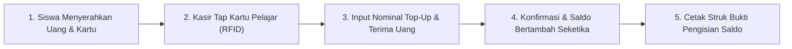

# Layanan Top-Up Saldo Siswa

Selain pengisian saldo secara mandiri oleh orang tua melalui Virtual Account bank pada portal siswa, loket kasir kantin dan koperasi sekolah juga menyediakan layanan **Isi Ulang Saldo Tunai (Cash Deposit)** bagi siswa yang membawa uang saku fisik ke sekolah.

Layanan ini memastikan setiap siswa dapat segera mengisi saldo kartu pelajarnya agar dapat berbelanja di kasir POS kantin tanpa hambatan.

---

## Alur Pengisian Saldo Tunai di Loket

---

## Langkah demi Langkah Layanan Top-Up:

1. **Tap Kartu Pelajar Siswa**:
   - Minta siswa menempelkan kartu fisiknya pada sensor RFID kasir, atau cari data siswa berdasarkan **NISN / Nama Lengkap**.
   - Layar kasir akan menampilkan Nama Siswa, Kelas, Foto, dan **Saldo Dompet Saat Ini**.

2. **Memasukkan Nominal Isi Ulang**:
   - Pilih tombol nominal cepat (misal: *Rp 10.000*, *Rp 20.000*, *Rp 50.000*, *Rp 100.000*) atau ketik nominal khusus sesuai uang tunai yang diserahkan siswa.
   - Terima uang fisik dari siswa dan hitung kesesuaian jumlahnya.

3. **Konfirmasi Pengisian Saldo**:
   - Klik tombol **`Konfirmasi Top-Up Saldo`**.
   - Sistem secara instan menambahkan nominal tersebut ke saldo kartu siswa secara realtime.

4. **Mencetak Struk Bukti Top-Up**:
   - Printer kasir thermal otomatis mencetak struk tanda terima berisi: No. Transaksi, Tanggal & Jam, Nama Siswa, Saldo Sebelum Top-Up, Nominal Ditambahkan, dan **Total Saldo Akhir**.
   - Serahkan struk bukti pengisian bersama kartu pelajar kembali kepada siswa.

---

## Ketentuan & Keamanan Saldo Siswa

- **Pemberitahuan Otomatis ke Orang Tua**: Setiap kali saldo kartu siswa bertambah melalui loket kasir, riwayat transaksi otomatis dapat dilihat oleh orang tua melalui Portal Siswa & Wali Murid.
- **Batas Maksimal Saldo Dompet (Wallet Balance Limit)**: Demi keamanan, sistem dapat membatasi saldo maksimal yang tersimpan di satu kartu pelajar (misal: maksimal Rp 500.000) untuk meminimalkan risiko kehilangan uang saku.
