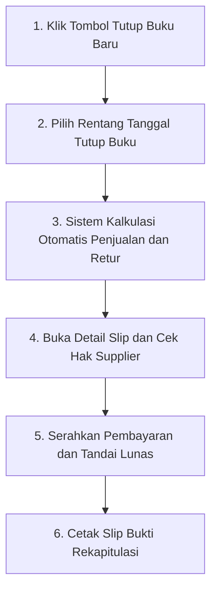

# Tutup Buku & Settlement Supplier

Fitur **Tutup Buku & Settlement Supplier** adalah modul akuntansi kasir kantin yang mengelola rekonsiliasi penjualan harian, pembagian komisi kantin sekolah, serta pencairan pembayaran bagi pedagang luar yang menitipkan makanannya di kantin (sistem konsinyasi).

Fitur ini dapat diakses oleh Administrator dan Pengelola Kantin melalui menu **Kantin** > **Tutup Buku & Settlement** pada sidebar aplikasi.

---

## Tampilan Halaman Tutup Buku & Settlement

Berikut adalah tampilan antarmuka manajemen tutup buku dan rekonsiliasi bagi hasil:

---

## 3 Metrik Keuangan Utama

Di bagian atas halaman, sistem menyajikan tiga indikator keuangan krusial:
1. **Total Omset Ter-settle (Total Sales)**:
   Total nilai kotor seluruh penjualan barang konsinyasi pada periode tutup buku yang dipilih.
2. **Total Komisi Kantin (Canteen Commission)**:
   Pendapatan bersih yang menjadi hak kas sekolah atau pengelola kantin (misal: 10% dari setiap makanan yang laku terjual).
3. **Total Payout Supplier (Supplier Payout)**:
   Uang bersih yang wajib dicairkan atau diserahkan kepada para pedagang titipan mitra kantin.

---

## Alur Menjalankan Tutup Buku Harian

Setiap sore hari setelah jam operasional sekolah selesai, kasir menjalankan proses tutup buku dengan alur berikut:

### Langkah-langkah:
1. Klik tombol ungu **`+ Proses Tutup Buku Baru`** di pojok kanan atas.
2. Jendela modal formulir tutup buku akan terbuka:
   - **Dari Tanggal & Sampai Tanggal**: Pilih rentang waktu transaksi yang ingin dihitung tutup bukunya (biasanya tanggal hari ini).
   - **Catatan Tutup Buku**: Tulis keterangan pengingat (contoh: *Tutup buku sore hari jam 16.00*).
3. Klik tombol **Jalankan Tutup Buku**.
4. Sistem seketika mengumpulkan seluruh transaksi POS pada periode tersebut, menghitung sisa barang retur yang tidak laku, memotong persentase komisi kantin, dan menerbitkan **Nomor Settlement** unik (misal: `SET-20261009-696`).

---

## Memeriksa Rincian per Pedagang (Detail Slip)

1. Pada tabel daftar settlement, klik tombol **`Detail Slip`** di baris transaksi terkait.
2. Jendela modal rincian slip akan menampilkan data akuntansi per supplier:
   - **Nama Supplier**: Identitas pedagang mitra titip jual.
   - **Jumlah Titip Awal (*Initial Qty*)**: Jumlah porsi makanan yang dibawa supplier di pagi hari.
   - **Jumlah Terjual (*Sold Qty*)**: Jumlah porsi makanan yang berhasil laku terjual di kasir POS.
   - **Jumlah Retur (*Returned Qty*)**: Jumlah makanan sisa yang dikembalikan ke supplier di sore hari.
   - **Omset Kotor (*Gross Revenue*)**: Total pendapatan dari makanan supplier tersebut.
   - **Hak Bersih Supplier (*Net Payout*)**: Nominal uang yang harus dibayarkan ke supplier setelah dipotong komisi kantin.
3. Anda dapat menekan tombol **`Cetak Slip Rekapitulasi`** untuk mencetak bukti perhitungan fisik bagi pedagang saat menyerahkan uang hasil jualan.

---

## Menandai Pelunasan Pembayaran Supplier

Setelah uang hak supplier diserahkan secara tunai atau ditransfer melalui rekening bank:

### 1. Pelunasan Satuan (Per Transaksi):
- Klik tombol hijau **`Lunas`** pada baris nomor settlement yang ingin diselesaikan.
- Jendela konfirmasi akan muncul. Masukkan catatan pembayaran (misal: *Ditransfer via BCA sore hari*), lalu klik **Ya, Konfirmasi LUNAS**.

### 2. Pelunasan Massal (*Bulk Action Bar*):
- Jika Anda ingin melunasi banyak rekapitulasi sekaligus di akhir pekan atau akhir bulan:
  1. Berikan tanda centang pada kotak di samping nomor-nomor settlement yang ingin dilunasi.
  2. Bilah hijau **Bulk Action Bar** akan muncul di atas tabel.
  3. Klik tombol **`Tandai Lunas Terpilih`**.
  4. Masukkan catatan pelunasan dan konfirmasi.
  5. Seluruh status settlement yang dipilih akan seketika berubah menjadi **Lunas**.
