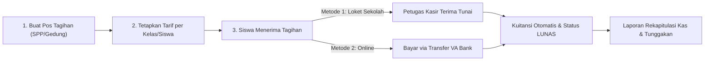

# Panduan Bendahara & Kasir Sekolah

Modul Keuangan adalah pusat pengelolaan seluruh transaksi dana sekolah, mencakup penerimaan SPP, tagihan kegiatan/gedung, tabungan siswa, kotak infaq, hingga laporan arus kas masuk dan rekonsiliasi bank.

---

## Alur Transaksi Keuangan

---

## Daftar Panduan di Bagian Ini

1. **[Menetapkan Tarif SPP & Pos Tagihan](/panduan-keuangan/setting-tagihan)**: Membuat pos pembayaran bulanan, pos pembayaran bebas, dan diskon beasiswa.
2. **[Pencatatan Pembayaran di Kasir (Loket)](/panduan-keuangan/pembayaran-kasir)**: Langkah menerima uang tunai dari siswa/wali murid dan mencetak kuitansi resmi.
3. **[Pembayaran Online (Virtual Account Bank)](/panduan-keuangan/pembayaran-online)**: Cara kerja pembayaran otomatis melalui transfer ATM/Mobile Banking BNI, BRI, dll.
4. **[Pengelolaan Tabungan Siswa & Dana Infaq](/panduan-keuangan/tabungan-infaq)**: Menyetor & menarik tabungan pintar siswa serta pencatatan infaq/sedekah.
5. **[Rekap Laporan Keuangan & Tunggakan](/panduan-keuangan/laporan-keuangan)**: Mencetak buku kas umum, memantau siswa yang menunggak, dan ekspor ke Excel.
