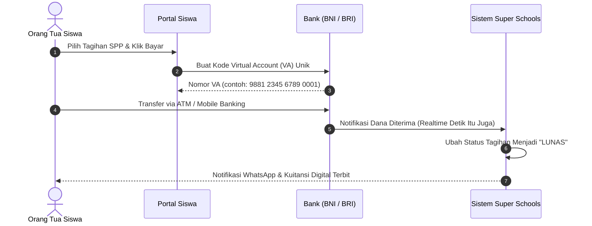

# Pembayaran Online (Virtual Account Bank)

Sistem telah terintegrasi dengan Payment Gateway bank nasional (seperti BNI dan BRI). Orang tua tidak perlu datang ke sekolah dan bendahara tidak perlu melakukan mutasi rekening manual.

---

## Cara Kerja Otomatisasi

---

## Cara Bendahara Memantau Transaksi Online

1. Buka menu **Keuangan** **Transaksi Online (Payment Gateway)**.
2. Anda dapat melihat filter transaksi:
   - **Sukses (Settled)**: Dana sudah masuk dan tagihan siswa sudah otomatis lunas.
   - **Menunggu Pembayaran (Pending)**: Nomor VA sudah dibuat tetapi siswa belum mentransfer sebelum batas waktu habis (expired).
   - **Kadaluarsa (Expired)**: VA tidak dibayar melewati batas waktu (biasanya 24 jam).
3. Jika terdapat pertanyaan dari orang tua *"Apakah pembayaran saya sudah masuk?"*, Bendahara cukup mencari nama siswa atau nomor referensi di halaman ini.
