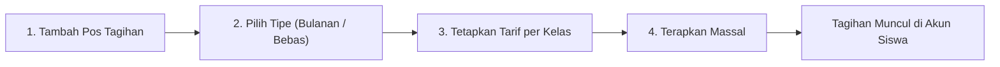

# Menetapkan Tarif SPP & Pos Tagihan

Sebelum siswa atau orang tua dapat melakukan pembayaran di loket maupun via online, Bendahara Sekolah harus membuat pos pembayaran dan menentukan nominal tagihan per kelas.

---

## Tampilan Manajemen Tagihan & Pembayaran

---

## 1. Memahami 2 Jenis Pos Pembayaran

Sistem membedakan pos tagihan menjadi 2 kategori:
1. **Tagihan Bulanan (SPP)**: Tagihan rutin setiap bulan selama 12 bulan (Juli sampai Juni).
2. **Tagihan Bebas / Non-Bulanan**: Tagihan yang dapat dicicil bertahap sesuai kemampuan siswa (contoh: Uang Gedung/Pangkal, Biaya Seragam, Karyawisata, Ujian).

---

## 2. Alur Membuat Pos Tagihan Baru

### Langkah-langkah:
1. Buka menu **Keuangan** **Pos Tagihan & Pembayaran**.
2. Klik tombol **`+ Tambah Pos Tagihan`**.
3. Masukkan nama pos (contoh: *SPP Tahun Ajaran 2026/2027*).
4. Pilih tipe pos pembayaran: **Bulanan** atau **Bebas**.
5. Klik **`Simpan Pos`**.

---

## 3. Menetapkan Tarif Nominal Tagihan

1. Pada pos pembayaran yang baru dibuat, klik tombol **`Atur Tarif`**.
2. Pilih rombel kelas target (misal: *Kelas 7 - AL FUQON*).
3. Masukkan nominal rupiah (misal: `Rp 350.000 / bulan`).
4. Klik tombol **`Terapkan ke Seluruh Siswa di Kelas Ini`**.
5. Sistem otomatis membuatkan 12 kartu tagihan bulanan pada setiap akun siswa di rombel tersebut.

::: tip Pengaturan Tarif Khusus Beasiswa
Jika ada siswa tertentu yang memperoleh potongan beasiswa 50% atau beasiswa prestasi penuh (gratis):
1. Buka tab **Tarif Khusus per Siswa**.
2. Cari nama siswa penerima beasiswa.
3. Ubah nominal sesuai ketentuan beasiswa lalu simpan.
:::
