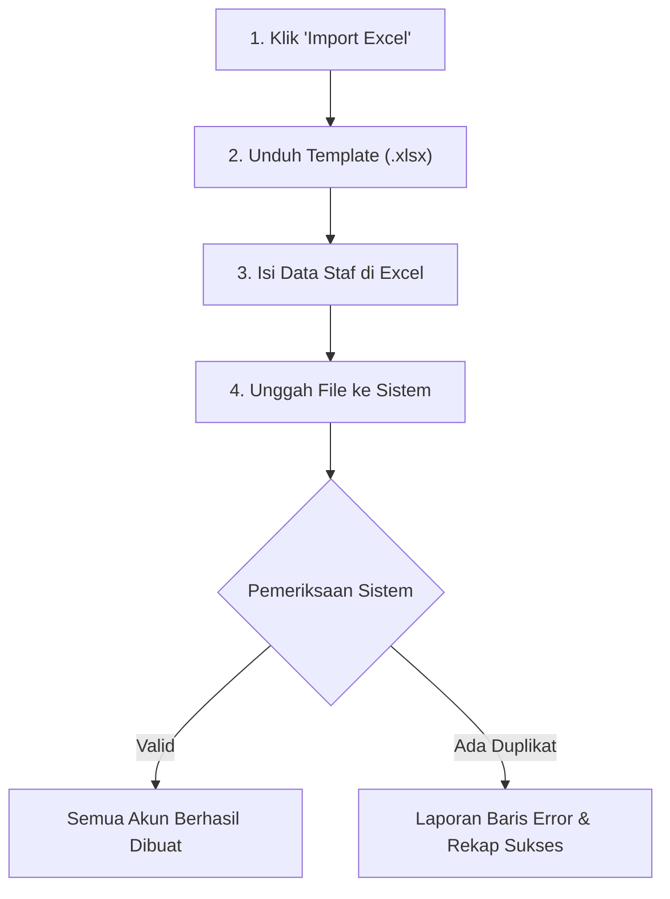

# Manajemen User (Daftar Pengguna)

Menu **Manajemen User** digunakan oleh Administrator Utama untuk mengontrol seluruh akun yang memiliki hak akses ke dalam aplikasi Super Schools, termasuk akun Guru, Tenaga Kependidikan, Tata Usaha, Kasir Kantin, hingga Wali Kelas.

---

## Tampilan Antarmuka Manajemen User

---

## 1. Pencarian & Filter Cepat Pengguna

Di atas tabel daftar pengguna, tersedia alat filter untuk menemukan akun secara cepat:
- **Kolom Pencarian (`Cari user...`)**: Cari pengguna berdasarkan **Nama Lengkap**, **Alamat Email**, atau **Username**.
- **Filter Role (`Semua Role`)**: Saring tampilan akun berdasarkan peran tertentu, misalnya hanya menampilkan akun *Wali Kelas*, *Bendahara*, atau *Super Admin*.
- **Tombol Refresh (`Refresh`)**: Memperbarui data tabel secara realtime dari server jika baru saja ada perubahan.

---

## 2. Alur Tambah User Baru

Ikuti langkah-langkah berikut untuk menambahkan pengguna baru secara manual:

### Langkah-langkah:
1. Klik tombol **`+ Tambah User`** berwarna ungu di pojok kanan atas tabel.
2. Modal jendela **Tambah User Baru** akan muncul. Isi data berikut:
   - **Nama Lengkap** *(Wajib)*: Masukkan nama lengkap pengguna beserta gelar (misal: `Ahmad Fauzi, S.Pd`).
   - **Email** *(Wajib)*: Masukkan email aktif (misal: `ahmad.fauzi@sekolah.sch.id`). Email ini berfungsi sebagai identitas pengiriman notifikasi dan pemulihan akun.
   - **Username** *(Wajib)*: ID unik pengguna untuk login ke aplikasi (misal: `ahmadfauzi`). Tidak boleh menggunakan spasi.
   - **Password** *(Wajib)*: Minimal 8 karakter. Disarankan perpaduan huruf dan angka (misal: `Sekolah2026!`).
   - **Konfirmasi Password** *(Wajib)*: Ketik ulang password untuk memastikan tidak ada salah ketik.
   - **Role** *(Wajib)*: Pilih salah satu peran dari dropdown (misal: *Administrator*, *Wali Kelas*, *Staff*, *Bendahara*).
3. Klik tombol **`Buat User`**.
4. Sistem akan memvalidasi data. Jika sukses, notifikasi hijau akan muncul dan akun baru langsung masuk ke dalam daftar tabel.

---

## 3. Alur Mengedit Data User

Jika staf mengalami perubahan nama, pergantian email, atau promosi peran:

1. Cari akun yang ingin diubah pada tabel pengguna.
2. Di kolom paling kanan (**Aksi**), klik tombol **Ikon Edit (Pensil)**.
3. Modal jendela **Edit User** akan terbuka dengan data yang sudah terisi otomatis:
   - Anda dapat mengubah **Nama Lengkap**, **Email**, atau **Role**.
   - **Kolom Password**: Pada mode edit, kolom password bersifat **opsional**. Jika Anda tidak ingin mengganti kata sandi pengguna, **biarkan kolom password kosong**.
4. Klik tombol **`Update User`** untuk menyimpan perubahan.

---

## 4. Alur Import Massal User via Excel

Jika Anda perlu mendaftarkan puluhan atau ratusan akun guru/staf sekaligus di awal tahun ajaran baru, gunakan fitur **Import Excel**:

### Langkah-langkah Detail:
1. Klik tombol **`Import Excel`** di atas tabel.
2. Pada modal yang muncul, klik tombol **`Unduh Template Excel`**.
3. Buka file template hasil unduhan di Microsoft Excel.
   - **Struktur Kolom**:
     - `name`: Nama lengkap pengguna.
     - `email`: Alamat email unik (tidak boleh sama dengan pengguna lain).
     - `username`: Username unik untuk login.
     - `password`: Password default awal (minimal 8 karakter).
     - `role`: Nama role persis sesuai sistem (misal: `guru`, `staff`, `bendahara`).
4. Simpan file yang telah diisi (format `.xlsx` atau `.xls`, ukuran maksimal 5 MB).
5. Tarik (*drag & drop*) file ke area unggah atau klik **Pilih File** untuk mencari file di komputer Anda.
6. Klik tombol **`Proses Import`**.
7. Sistem akan memproses data dan menampilkan dialog rekapitulasi:
   - **Jumlah Berhasil**: Total akun yang sukses didaftarkan.
   - **Jumlah Gagal / Duplikat**: Jika ada baris dengan email atau username yang sudah terdaftar sebelumnya, sistem akan menandai nomor baris tersebut agar dapat Anda perbaiki.

---

## 5. Alur Export Data User ke Excel

Fitur ini berguna untuk membuat laporan arsip data kepegawaian atau rekap akun pengguna:

1. *(Opsional)* Terapkan filter terlebih dahulu jika Anda hanya ingin mengekspor kelompok tertentu (misal: filter Role = *Wali Kelas*).
2. Klik tombol **`Export Excel`** di atas tabel.
3. Sistem akan secara otomatis mengompilasi data dan mengunduh file spreadsheet `.xlsx` ke komputer Anda.
4. File unduhan memuat informasi: ID Pengguna, Nama Lengkap, Email, Username, Role, Status Akun, dan Tanggal Dibuat.

---

## 6. Alur Menonaktifkan / Menghapus Akun

Jika staf atau guru sudah mutasi atau tidak lagi bertugas di sekolah:

1. Pada tabel pengguna, centang kotak di samping nama akun yang bersangkutan, atau klik tombol **Hapus (Ikon Tempat Sampah)** pada baris user.
2. Jendela konfirmasi keamanan **Hapus User** akan muncul:
   - Terdapat peringatan dampak penghapusan akun.
3. Klik tombol merah **`Ya, Hapus User`**.
4. Akun tersebut tidak lagi dapat digunakan untuk masuk (*login*) ke portal sekolah.

::: tip Tips Keamanan Akun
Sebaiknya jangan memberikan role **Super Admin** kepada staf biasa. Berikan role sesuai tugas pokok fungsinya (misal: TU cukup role *Staff*, guru pengajar role *Guru*, bendahara role *Bendahara*) agar hak akses sistem tetap tertib dan aman.
:::
